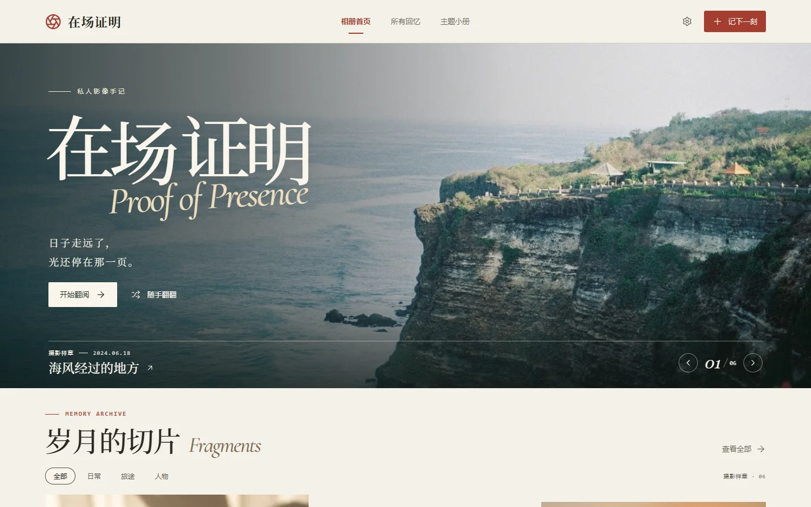

# 在场证明 · Proof of Presence

日子走远了，光还停在那一页。

一本能继续写下去的中文私人摄影集。将照片从墙上展开，翻到背面读手记，几年后再补上一行后记。内置摄影样章可供试读，自己的相册从空白开始。



## 可以做什么

- 存照片，也可以只写一句话。日期可以是某一天、某一年，或「小时候的夏天」。
- 按人物、地点和文字找回一段记忆，把同一段记忆编进不同的主题小册。
- 手机选图后即可写字，草稿保存在当前浏览器，上传失败的照片可以单独重试。
- 完整备份包含原图、手记、后记和小册顺序。赠阅包只包含选中的小册，解压后用浏览器打开 `index.html` 即可离线翻阅。
- 封面幕片、逐字入场、照片展开与翻面支持系统的减少动态效果设置。

## 在本地运行

需要 Node.js 22.13 或更高版本，以及 npm。克隆仓库并从根目录执行：

```sh
npm ci
npm run build
node --import ./scripts/sites-env.mjs ./node_modules/wrangler/bin/wrangler.js d1 execute DB --local --config dist/server/wrangler.json --persist-to .wrangler/state --file drizzle/0000_dashing_onslaught.sql
npm run dev -- --hostname 127.0.0.1
```

建表命令用于首次初始化新的本地数据库。之后直接运行最后一条命令，打开终端显示的地址即可。类型检查使用 `npx tsc --noEmit`。

## 存储与部署

前端使用 React、TypeScript 和 Vinext。D1 存回忆和小册，R2 按所有者和文件摘要保存原图、预览及缩略图。本地使用模拟的 D1、R2 和回环地址开发登录。

生产身份由 Sites 网关注入，资料 API 按所有者校验访问权限。部署自己的实例时，请绑定自己的 Sites 项目、D1 和 R2，并启用所有者私密访问。迁移到其他托管平台时，需要用可信服务端身份认证替换 Sites 网关，防止客户端伪造身份请求头。

## 许可与署名

- 项目原创代码使用 [MIT License](LICENSE)。
- 八组摄影样章使用 [Pexels License](https://www.pexels.com/license/)。[摄影师与每张照片的原始链接](public/photos/credits.json)。
- 封面使用 Noto Serif SC 与 Cormorant Garamond 的字体子集，均采用 SIL Open Font License 1.1。[宋体许可](public/type/folio-song-OFL.txt) · [斜体许可](public/type/folio-italic-OFL.txt)。
- 随仓库分发的第三方组件及构建插件保留原有许可。[shadcn](vendor/shadcn-tailwind-4.13.0.LICENSE.md) · [Sites Vite 插件](scripts/vite/sites-vite-plugin.LICENSE)。
